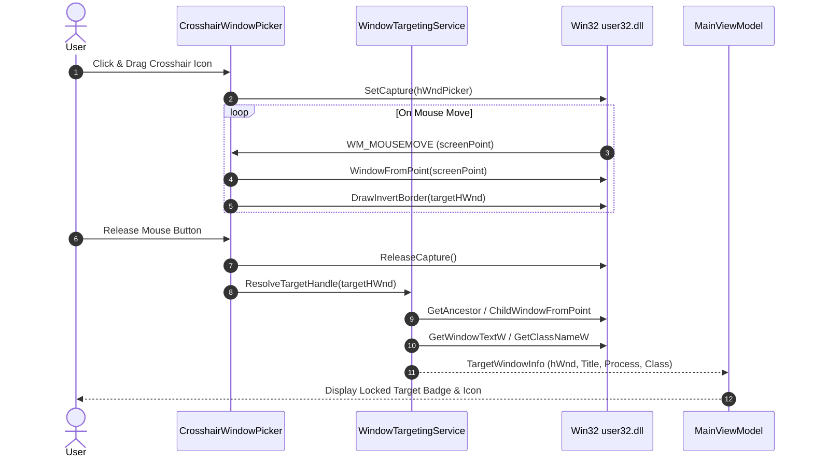
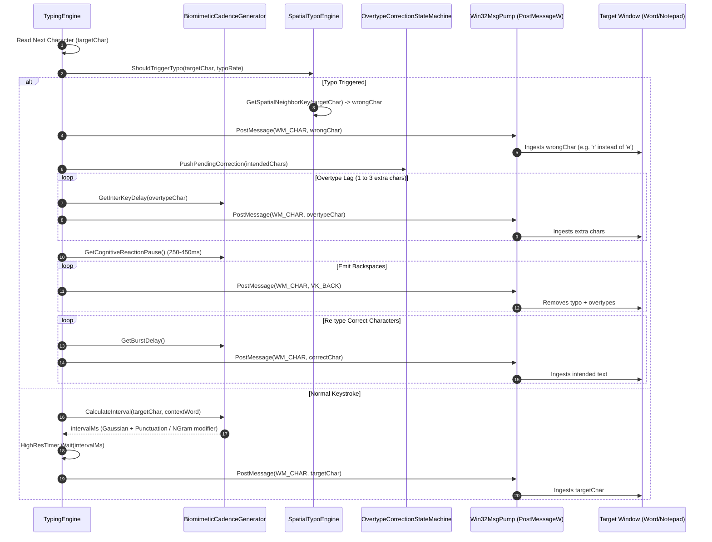
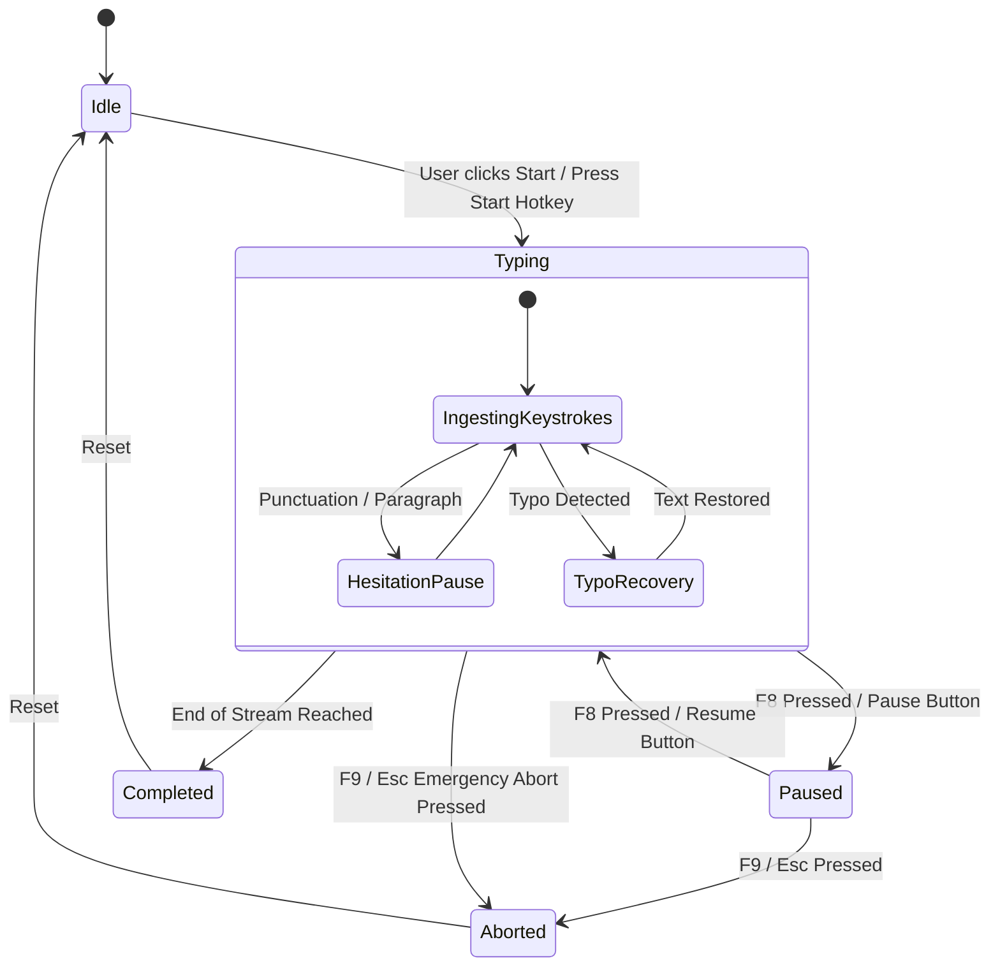

# 3. System Architecture Design — Humanesque Typer

> **Project**: Humanesque (Humanesque Typer)  
> **Status**: Approved Specification  
> **Version**: 1.0.0  
> **Pattern**: MVVM + Layered Clean Architecture  

---

## 1. System Component Architecture

The application is structured into four distinct, loosely coupled layers: **Presentation (WPF / MVVM)**, **Application & Services**, **Domain Engine**, and **Native Win32 Infrastructure**.

```mermaid
flowchart TD
    subgraph UI ["Presentation Layer (WPF / XAML)"]
        MainWindow["MainWindow (Editor & Target Controls)"]
        SettingsDialog["SettingsWindow (Sliders & Profiles)"]
        OnboardingWizard["OnboardingWizard (Setup & Typing Test)"]
        FloatingPill["FloatingPillWindow (Discreet Overlay)"]
        SystemTray["SystemTrayIcon (NotifyIcon + Context Menu)"]
    end

    subgraph VM ["ViewModel Layer (CommunityToolkit.Mvvm)"]
        MainVM["MainViewModel"]
        SettingsVM["SettingsViewModel"]
        OnboardingVM["OnboardingViewModel"]
        FloatingPillVM["FloatingPillViewModel"]
    end

    subgraph ServiceLayer ["Application & Services Layer"]
        WindowService["WindowTargetingService"]
        DocService["DocumentIngestionService"]
        ConfigService["ConfigurationService"]
        HotkeyService["GlobalHotkeyManager"]
        CalibrationService["TypingCalibrationService"]
    end

    subgraph EngineLayer ["Core Simulation Engine (Domain)"]
        TypingEngine["TypingEngine (Background Orchestrator)"]
        CadenceGen["BiomimeticCadenceGenerator"]
        TypoEngine["SpatialTypoEngine (QWERTY Distance)"]
        CorrectionSM["OvertypeCorrectionStateMachine"]
        NGramBurst["NGramBurstDetector"]
    end

    subgraph NativeLayer ["Native Windows Infrastructure"]
        Win32MsgPump["Win32 PostMessage Dispatcher (WM_CHAR)"]
        SendInputFallback["Foreground SendInput Dispatcher"]
        HighResTimer["HighResolutionMultimediaTimer (winmm)"]
        WindowPickerHook["CrosshairWindowPicker (SetCapture)"]
    end

    %% UI to ViewModel bindings
    MainWindow <--> MainVM
    SettingsDialog <--> SettingsVM
    OnboardingWizard <--> OnboardingVM
    FloatingPill <--> FloatingPillVM

    %% ViewModels to Services
    MainVM --> TypingEngine
    MainVM --> WindowService
    MainVM --> DocService
    MainVM --> HotkeyService
    SettingsVM --> ConfigService
    OnboardingVM --> CalibrationService

    %% Engine interactions
    TypingEngine --> CadenceGen
    TypingEngine --> TypoEngine
    TypingEngine --> CorrectionSM
    TypingEngine --> NGramBurst
    TypingEngine --> Win32MsgPump
    TypingEngine --> SendInputFallback
    TypingEngine --> HighResTimer

    %% Native services
    WindowService --> WindowPickerHook
```



---

## 2. Sequence & Data Flow Diagrams

### 2.1 Window Target Selection Flow


### 2.2 Biomimetic Typing Execution & Typo Correction Loop


### 2.3 Global Hotkey Interruption State Diagram


---

## 3. Core Data & Metadata Schemas

### 3.1 Typing Profile (`TypingProfile.cs`)
```csharp
namespace Humanesque.Models;

public record TypingProfile
{
    public required string Id { get; init; }
    public required string Name { get; init; } // "Slow", "Average", "Fast", "Custom"
    public required double TargetWpm { get; init; }
    public required double WpmVariance { get; init; } // Standard deviation for Gaussian distribution
    
    // Typo Simulation Parameters
    public required double TypoRatePercent { get; init; } // e.g. 1.8%
    public required int MinOvertypeCount { get; init; } // e.g. 1
    public required int MaxOvertypeCount { get; init; } // e.g. 3
    public required int ReactionDelayMinMs { get; init; } // e.g. 220ms
    public required int ReactionDelayMaxMs { get; init; } // e.g. 480ms
    
    // Cadence & Pause Modifiers
    public required double CommonWordBurstFactor { get; init; } // e.g. 0.65 (35% faster)
    public required int CommaPauseMinMs { get; init; } // e.g. 150ms
    public required int CommaPauseMaxMs { get; init; } // e.g. 350ms
    public required int PeriodPauseMinMs { get; init; } // e.g. 400ms
    public required int PeriodPauseMaxMs { get; init; } // e.g. 900ms
    public required int ParagraphPauseMinMs { get; init; } // e.g. 900ms
    public required int ParagraphPauseMaxMs { get; init; } // e.g. 2200ms
}
```

### 3.2 Target Window Info (`TargetWindowInfo.cs`)
```csharp
namespace Humanesque.Models;

public record TargetWindowInfo
{
    public required IntPtr Handle { get; init; }
    public required IntPtr EditControlHandle { get; init; }
    public required string WindowTitle { get; init; }
    public required string ProcessName { get; init; }
    public required string ClassName { get; init; }
    public required int ProcessId { get; init; }
    public bool IsModernApp { get; init; } // True if Modern Notepad / UWP / Chromium
}
```

### 3.3 Session Telemetry & Statistics (`SessionStats.cs`)
```csharp
namespace Humanesque.Models;

public class SessionStats
{
    public int TotalCharacters { get; set; }
    public int CharactersTyped { get; set; }
    public int TyposIntroduced { get; set; }
    public int BackspacesDispatched { get; set; }
    public double CurrentWpm { get; set; }
    public double AverageWpm { get; set; }
    public TimeSpan ElapsedTime { get; set; }
    public TimeSpan EstimatedTimeRemaining { get; set; }
    public double ProgressPercentage => TotalCharacters > 0 
        ? (double)CharactersTyped / TotalCharacters * 100.0 
        : 0.0;
}
```
