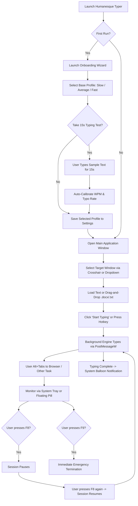

# 4. UI/UX Design Specification — Humanesque Typer

> **Project**: Humanesque (Humanesque Typer)  
> **Status**: Approved Specification  
> **Version**: 1.0.0  
> **Visual Design**: Modern Fluent / Dark-Themed Desktop Desktop App  

---

## 1. Application Shell & Window Wireframes

Humanesque Typer features a sleek, modern desktop interface with high DPI clarity, subtle acrylic backdrop effects, and distinct visual sections: **Targeting Bar**, **Document Editor / Import Area**, **Mode & Speed Preset Selector**, and **Live Status Bar**.

```
+-----------------------------------------------------------------------------------+
|  [H] Humanesque Typer                             [ _ ]  [ [] ]  [ X ]            |
+-----------------------------------------------------------------------------------+
|  TARGET WINDOW:                                                                   |
|  [ 🎯 Drag to Window ]  [ ▼ Document1 - Microsoft Word                 ] [ 🔒 Lock ] |
|  Status: Ready | Handle: 0x002B08F2 | Process: WINWORD.EXE                        |
+-----------------------------------------------------------------------------------+
|  SPEED MODE:                                                                      |
|  ( ) Slow (~30 WPM)       (*) Average (~60 WPM)       ( ) Fast (~95 WPM)  [⚙ Tuning]|
+-----------------------------------------------------------------------------------+
|  DOCUMENT INPUT:                                   [ 📁 Import File (.txt/.docx) ]|
|  +-----------------------------------------------------------------------------+  |
|  | The quick brown fox jumps over the lazy dog. Realistic biomimetic typing    |  |
|  | includes variable pauses between phrases, occasional spatial typos with     |  |
|  | natural backspace corrections, and faster bursts across frequent words.     |  |
|  |                                                                             |  |
|  |                                                                             |  |
|  +-----------------------------------------------------------------------------+  |
|  Words: 42 | Characters: 278 | Estimated Duration: 46s                            |
+-----------------------------------------------------------------------------------+
|  [  ▶  Start Typing  ]    [  ⏸  Pause (F8)  ]    [  ⏹  Stop (F9)  ]             |
|                                                                                   |
|  Progress: [██████████████████░░░░░░░░░░░░] 58%  | WPM: 64.2  | Typos Fixed: 3     |
|  Hotkeys: F8 = Pause/Resume | F9 = Emergency Abort | Ctrl+Shift+T = Lock Active   |
+-----------------------------------------------------------------------------------+
```

---

## 2. Key User Interaction Flows



---

## 3. Component Tree & Hierarchy

```
App.xaml (Theme Resources, Brushes, System Tray Setup)
└── MainWindow.xaml (Main Host Shell)
    ├── TitleBarControl (Icon, Title, Minimize, Maximize, Close)
    ├── TargetWindowBarControl
    │   ├── CrosshairPickerButton (Drag to capture target)
    │   ├── WindowComboBox (Live enumeration of top-level windows)
    │   ├── RefreshWindowsButton
    │   └── TargetStatusBadge (Process name, PID, Class, State indicator)
    ├── ProfileSelectorControl
    │   ├── RadioButtonGroup (Slow, Average, Fast)
    │   ├── ProfileSummaryBadge (Target WPM, Typo Rate %)
    │   └── OpenSettingsButton (Launches Settings modal)
    ├── DocumentEditorControl
    │   ├── ImportToolbar (Import File button, Clear button, Paste button)
    │   ├── DragDropTextArea (Scrollable input text box with drop listener)
    │   └── DocumentStatsBar (Word count, character count, estimated time)
    ├── SessionControlBar
    │   ├── StartTypingButton (Accent color, icon)
    │   ├── PauseResumeButton (Disabled when idle, hotkey F8)
    │   ├── EmergencyStopButton (Danger color, hotkey F9)
    │   ├── ProgressBar (Smooth transition animation)
    │   └── TelemetryBar (Live WPM counter, Typos corrected counter)
    └── HotkeyLegendBar (Status and active shortcut reminders)

Auxiliary Windows / Dialogs:
├── OnboardingWizardWindow.xaml
│   ├── Step1_WelcomeScreen
│   ├── Step2_PresetSelection
│   ├── Step3_TypingCalibrationTest (Interactive test box, countdown, real-time WPM)
│   └── Step4_HotkeySummary
├── SettingsWindow.xaml
│   ├── GeneralTab (Start minimized, Floating pill enabled, Sound cues)
│   ├── ProfilesTab (Detailed sliders: WPM, Gaussian variance, Typo %, Pauses)
│   └── HotkeysTab (Rebindable hotkeys for Lock, Pause, Abort)
└── FloatingPillWindow.xaml
    ├── MinimalProgressBar
    ├── CompactWpmCounter
    └── MiniPauseResumeButton
```

---

## 4. Design Tokens & Visual Specifications

### 4.1 Color Palette (Dark Theme Default)
| Token Name | Hex Value | Usage |
| :--- | :--- | :--- |
| `BackgroundPrimary` | `#121214` | Main window surface background |
| `BackgroundSecondary` | `#1C1C21` | Input area, card backgrounds, panels |
| `BackgroundTertiary` | `#26262E` | Hovered controls, borders, dropdown lists |
| `AccentPrimary` | `#6366F1` | Primary CTA, active toggles, focus rings (Indigo) |
| `AccentHover` | `#4F46E5` | Button hover states |
| `TextPrimary` | `#F8FAFC` | Primary headings, document text |
| `TextSecondary` | `#94A3B8` | Subtitles, labels, metadata badges |
| `StatusSuccess` | `#10B981` | Ready status, completed progress, verified handle |
| `StatusWarning` | `#F59E0B` | Paused state, Modern App warning |
| `StatusDanger` | `#EF4444` | Emergency abort button, invalid handle |

### 4.2 Typography
- **Primary Interface Font**: `Segoe UI Variable Text` / `Segoe UI` (9pt - 11pt, Regular & SemiBold).
- **Monospace Code/Text Font**: `Cascadia Code` / `Consolas` (10pt, for document editor and stats).
- **Heading Font**: `Segoe UI Variable Display` (14pt - 18pt, Bold).

### 4.3 Component States
- **Target Crosshair**: Default crosshair cursor; when dragging, cursor transforms into a target scope; background windows highlight with an inverted outline rectangle upon hover.
- **Floating Status Pill**: Borderless, semi-transparent (`Opacity = 0.88`), draggable across any screen corner, stays on top (`Topmost = True`), click-through mode togglable.
