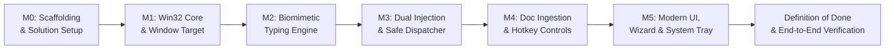

# 6. Implementation Plan & Development Roadmap — Humanesque Typer

> **Project**: Humanesque (Humanesque Typer)  
> **Status**: Approved Specification  
> **Version**: 1.0.0  
> **Order of Execution**: Milestones M0 $\rightarrow$ M5  

---

## 1. Milestones Overview



---

## 2. Granular Milestone Checklist

### Milestone 0: Project Scaffolding & Core Architecture Setup
- [ ] Initialize master solution `Humanesque.sln` and WPF project `src/Humanesque/Humanesque.csproj` targeting `net10.0-windows` (with `net8.0-windows` compatibility).
- [ ] Initialize xUnit test project `tests/Humanesque.Tests/Humanesque.Tests.csproj`.
- [ ] Configure NuGet dependencies:
  - `CommunityToolkit.Mvvm` (8.3+)
  - `DocumentFormat.OpenXml` (3.1+)
  - `Markdig` (0.37+)
- [ ] Establish directory structure (`Core/`, `Native/`, `Models/`, `Services/`, `ViewModels/`, `Views/`).
- [ ] Setup high-DPI awareness (`PerMonitorV2`) and dark theme resource dictionary.
- [ ] **Verification**: `dotnet build` compiles cleanly with 0 warnings/errors.

### Milestone 1: Win32 Native Core & Window Targeting
- [ ] Implement `NativeMethods.cs` with P/Invoke signatures (`PostMessageW`, `SendMessageW`, `EnumWindows`, `WindowFromPoint`, `SetCapture`, `ReleaseCapture`, `RegisterHotKey`).
- [ ] Implement `WindowTargetHelper.cs` to enumerate running desktop windows and filter hidden/system processes.
- [ ] Implement `CrosshairPicker.cs` mouse-drag listener with cursor coordinate conversion and window boundary highlight overlay.
- [ ] Implement child control resolution for Word (`_WwG`), Notepad (`Edit` / `RichEditD2DPT`), and standard edit controls.
- [ ] Unit tests in `Win32InteropTests.cs` verifying window handle retrieval and class name extraction.

### Milestone 2: Biomimetic Human Typing Simulation Engine
- [ ] Implement `KeyboardLayoutMatrix.cs` defining 2D physical coordinates for all QWERTY keys.
- [ ] Implement `SpatialTypoEngine.cs` computing Euclidean key distances and picking realistic neighbor typo candidates.
- [ ] Implement `OvertypeStateMachine.cs` orchestrating 1–3 char overtype lag, cognitive pause, backspaces, and correct re-typing.
- [ ] Implement `BiomimeticCadence.cs` generating Gaussian intervals via Box-Muller transform with punctuation multipliers.
- [ ] Implement `NGramBurstDetector.cs` with top 100 English digraphs/trigraphs for muscle-memory burst acceleration.
- [ ] Unit tests in `CadenceTests.cs` and `TypoEngineTests.cs` verifying Gaussian distribution variance and typo spatial accuracy.

### Milestone 3: Smart Dual Injection & Safe Dispatcher
- [ ] Implement `InputDispatcher.cs` supporting pure background `PostMessageW(WM_CHAR)` without focus stealing.
- [ ] Implement `HighResolutionTimer.cs` using `timeBeginPeriod(1)` to bypass Windows 15ms `Thread.Sleep` jitter.
- [ ] Implement foreground fallback mode using `SendInput` with 5-second preparation countdown for modern web apps.
- [ ] Implement thread-safe cancellation and pause tokens in `TypingEngine.cs`.
- [ ] Verification test: Run background typing into Notepad while user actively types in a separate text editor.

### Milestone 4: Document Ingestion, Calibration & Hotkeys
- [ ] Implement `DocumentIngestionService.cs` supporting direct text input, `.txt`, `.md`, and `.docx` (OpenXML) text extraction.
- [ ] Implement `GlobalHotkeyManager.cs` hooking `F8` (Pause/Resume), `F9` (Emergency Abort), and `Ctrl+Shift+T` (Lock Window).
- [ ] Implement `TypingCalibrationService.cs` providing a 15-second typing benchmark that analyzes user WPM and error rate to customize profiles.
- [ ] Implement `ConfigurationService.cs` persisting settings and profiles to `%APPDATA%\Humanesque\settings.json`.

### Milestone 5: Modern UI, Onboarding Wizard & System Tray
- [ ] Build `MainWindow.xaml` with modern Fluent dark theme, Target Window Bar, Mode Selector, Editor, and Telemetry Bar.
- [ ] Build `OnboardingWindow.xaml` for first-run experience: welcome screen, profile selection, and optional 15s calibration test.
- [ ] Build `SettingsWindow.xaml` with fine-tuning sliders for WPM, typo error rate %, pause durations, and hotkey bindings.
- [ ] Build `FloatingPillWindow.xaml` discreet transparent overlay displaying live progress and WPM.
- [ ] Build `SystemTrayManager.cs` with taskbar notification icon, context menu, and completion balloon notifications.
- [ ] Connect all ViewModels using `CommunityToolkit.Mvvm` `[ObservableProperty]` and `[RelayCommand]`.

---

## 3. Verification Plan & Definition of Done

### Automated Test Suite
```powershell
# Run all unit and integration tests
dotnet test tests/Humanesque.Tests/Humanesque.Tests.csproj --verbosity normal
```
*Expected criteria*:
- `CadenceTests`: Validates mean delay and Gaussian variance within $\pm 4\%$ of target profile.
- `TypoEngineTests`: Validates 100% of generated typos are adjacent QWERTY neighbors.
- `DocumentParserTests`: Validates 100% character and newline fidelity across `.txt`, `.md`, and `.docx` fixtures.

### Manual End-to-End Verification
1. **Background Typing into Microsoft Word**:
   - Open Microsoft Word with a blank document.
   - Launch Humanesque Typer, drag the crosshair over Word to lock its handle.
   - Load a sample paragraph in Humanesque.
   - Click **Start Typing**, immediately Alt+Tab to a web browser, and type a search query.
   - **Verification**: Browser input is undisturbed; Word document receives human-cadenced text with occasional typos and backspace corrections in the background.
2. **Global Hotkey Safety**:
   - While typing in the background, press `F8` $\rightarrow$ verify typing halts instantly.
   - Press `F8` again $\rightarrow$ verify typing resumes seamlessly from the exact character index.
   - Press `F9` $\rightarrow$ verify session terminates immediately.
3. **Onboarding & Settings Persistence**:
   - Run first-run onboarding wizard, complete optional 15s typing calibration.
   - Verify calibrated profile is saved to `%APPDATA%\Humanesque\settings.json` and loaded on subsequent restarts.

---

## 4. Decisions Log

| # | Topic | Decision | Justification |
| :---: | :--- | :--- | :--- |
| **D1** | **Tech Stack** | **C# / .NET 10 LTS (WPF)** | Provides direct native access to Win32 message pumps (`PostMessageW`), UI Automation, and high-performance desktop graphics with zero Node/Python environment overhead. |
| **D2** | **Project Name** | **Humanesque (Humanesque Typer)** | Directly matches workspace name; conveys biomimetic, human-like typing cadence and imperfection simulation. |
| **D3** | **Background Injection** | **Pure Background Win32 `PostMessageW` (Default)** with Foreground `SendInput` Fallback | Guarantees zero focus stealing for native apps (Word, Notepad), while retaining compatibility for web apps that block background messages. |
| **D4** | **Target Selection** | **Crosshair Picker + Live Dropdown + `Ctrl+Shift+T`** | Gives maximum flexibility: visual point-and-click, list selection, or hotkey instant lock. |
| **D5** | **Human Typo Mechanics** | **Spatial QWERTY Matrix + Overtype Lag + Backspaces** | Ensures simulated typos mimic true finger slips rather than artificial random characters. |
| **D6** | **Multitasking Monitoring**| **Global Hotkeys (`F8`/`F9`) + Tray + Floating Pill** | Empowers user to monitor and control typing from any screen without bringing the main window to front. |
| **D7** | **Document Formats** | **Direct Paste, `.txt`, `.md`, `.docx`** | Covers all primary user workflows with OpenXML high-fidelity text extraction. |
